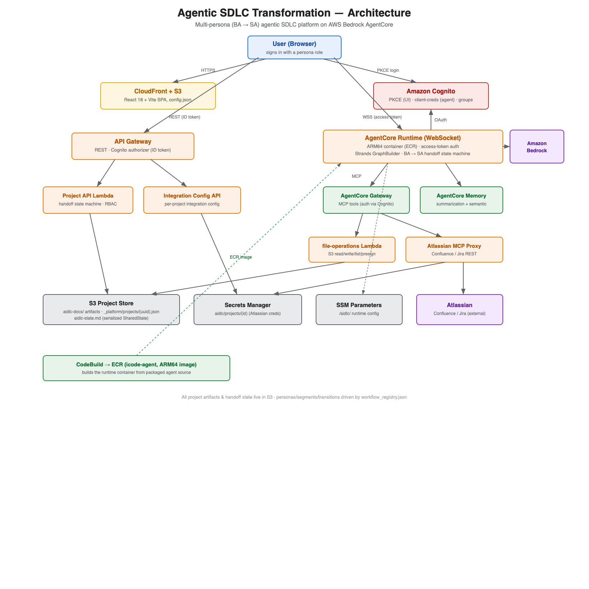

# Agentic SDLC Transformation

> ⚠️ **Non-production sample.** This repository is a demonstration / reference project for workshops and evaluation. It is **not intended for production use** — it provisions demo users, uses permissive defaults (e.g. broad IAM on first deploy), and makes sandbox assumptions. Review and harden security, IAM, secrets management, and availability before any real deployment. Provided "as is", without warranty (see [LICENSE](LICENSE)).

A multi-persona, agent-driven collaboration platform for the full software development lifecycle, built on AWS. Six AI-assisted personas work the same project in sequence: a **Business Analyst** uploads requirements and produces user stories; a **Solution Architect** reviews them and produces NFRs, design, and architecture; a **Software Developer** receives the finished design as a downloadable **construction brief**, codes in an AI-assisted IDE, and pushes to GitHub/GitLab; a **QA Engineer** tests the ingested code; and a **DevOps Engineer** plans and releases it — with a read-only **Maintenance Specialist** operations dashboard across it all. The developer's repository is pulled back into the platform (the **Git round-trip**) so QA and DevOps operate on the real code.

The platform runs on Amazon Bedrock AgentCore (Runtime, Gateway, Memory) with a Strands GraphBuilder orchestrator behind a React web UI. Users sign in with a persona role, see only the actions their role permits, and pass projects forward through an explicit handoff state machine.

> Looking for step-by-step deployment instructions, login flow, and the BA → SA workflow? See the [User Guide](docs/user-guide.md).
>
> New to the platform as a user? Start with the [User Documentation guide set](docs/guide/README.md) — overview, architecture, and per-persona walkthroughs.

---

## Table of contents

- [Why is this relevant?](#why-is-this-relevant)
- [Architecture](#architecture)
- [Repository layout](#repository-layout)
- [Prerequisites](#prerequisites)
- [Quick start](#quick-start)
- [Stack outputs](#stack-outputs)
- [Personas and the handoff state machine](#personas-and-the-handoff-state-machine)
- [Tear down](#tear-down)
- [Project structure deep dive](#project-structure-deep-dive)
- [Tests](#tests)
- [Contributing](#contributing)
- [License](#license)

---

## Why is this relevant?

Agentic SDLC Transformation showcases how multiple AI personas can collaborate across the SDLC under explicit human control. It demonstrates how to leverage agentic AI to accelerate software architecture design and development — generating standardized patterns, optimizing configurations, ensuring compliance, and creating documentation — with clear handoffs between roles.

The methodology behind it emphasizes two dimensions:

- **AI-Powered Execution with Human Oversight.** AI systematically creates detailed work plans, actively seeks clarification, and defers critical decisions to humans. Only humans possess the contextual understanding and knowledge of business requirements needed to make informed choices.
- **Dynamic Team Collaboration.** As AI handles routine tasks, teams unite in collaborative spaces for real-time problem-solving and rapid decision-making. The shift from isolated work to high-energy teamwork accelerates innovation and delivery.

<p align="center">
  
</p>


**Who is this for?** Product owners, project managers, architects, and engineering leaders who want to reduce the operational burden of a standard development lifecycle and explore how multi-persona agentic AI can accelerate cloud-native software delivery.

---

## Architecture

User interactions flow from the React Portal through an orchestration layer to specialized AI agents, which leverage **MCP (Model Context Protocol)** tools through an Amazon Bedrock AgentCore Gateway. All artifacts live in Amazon S3 as the central repository for project state and generated work products. The shared Project Store (`_platform/projects/{uuid}.json` in the same bucket) is the authoritative record of each project's handoff state and assignment history; SharedState mirrors it for resume durability.

<p align="center">
  
</p>

Key components:

- **Persona/Workflow Registry** — `workflow_registry.json` is the single source of truth for personas, segments, states, and the legal handoff transitions. Both the Python runtime and the TypeScript frontend read it; the Project API enforces it.
- **Orchestrator** — Strands GraphBuilder graph covering the inception, design, and developer-handoff segments. A registry-derived `handoff_gate__{segment}` node is inserted on every segment boundary (BA → SA and SA → Developer), so the owning persona's session halts there and the next persona reconnects through a fresh session.
- **Stage agents** — Specialist agents per stage: requirements analysis (with optional document upload), user stories, workflow planning, application design, units generation, inception complete, and the developer-side construction handoff (which packages the construction brief).
- **Project API** — API Gateway + Lambda backed by the S3 project store. Serves the cross-creator project list, applies handoff transitions atomically (ETag-conditional `PutObject`), and mints short-lived presigned upload URLs.
- **Gateway** — AWS Bedrock AgentCore Gateway with MCP. Wraps Lambda tools for file ops, integrations, and document text extraction (`.md`/`.txt` passthrough; `.pdf` via `pypdf`; `.docx` via `python-docx`).
- **Memory** — AWS Bedrock AgentCore Memory (summarization + semantic).
- **Frontend** — React 18 + Vite + TypeScript, deployed to S3 + CloudFront. Hosts the project list, the per-project workspace (chat, file browser, document viewer), the BA's requirements upload control, the SA's review panel, the handoff card, and the per-project status badge.
- **Auth** — Amazon Cognito User Pool (PKCE for the UI, client credentials for agent ↔ Gateway). The user's persona is selected at sign-up, recorded as the `custom:role` attribute, and assigned to the matching Cognito group by a post-confirmation Lambda trigger.

For more detail, see [`code/docs/ARCHITECTURE.md`](code/docs/ARCHITECTURE.md).

---

## Repository layout

```
.
├── README.md                       ← this file
├── docs/
│   ├── images/                     ← architecture + portal screenshots
│   └── user-guide.md               ← step-by-step deploy + login + BA→SA walkthrough
├── package.json                    ← root scripts: deploy-infrastructure, delete-infrastructure
├── scripts/
│   ├── package-assets.sh           ← stages and uploads deployment assets to s3://aidlc-assets-…
│   ├── package-code.sh             ← repackages Lambda zips when source changes
│   └── verify-two-persona-handoff.sh ← scripted BA→SA end-to-end verification
├── cdk/                            ← CDK app
│   ├── bin/cdk.ts                  ← entrypoint with the account-mismatch guard
│   ├── lib/
│   │   ├── aidlc-platform.ts       ← top-level stack
│   │   ├── aidlc-platform-auth.ts  ← Cognito User Pool + PKCE client + post-confirm trigger + 4 test users (single provisioner)
│   │   ├── aidlc-platform-agents.ts← AgentCore Runtime/Gateway/Memory + Project API
│   │   ├── aidlc-platform-ui.ts    ← S3 + CloudFront, /config.json generation
│   │   ├── aidlc-platform-builds.ts← CodeBuild for the ARM64 agent container
│   │   └── utils/account-guard.ts  ← deploy guard for the pinned account
│   └── custom-resources/           ← Project API + post-confirmation Lambda
├── code/
│   ├── agentcore-runtime/          ← Strands graph + stage agents (Python)
│   ├── agentcore-gateway/          ← Gateway tool Lambdas (Python): file ops, integrations, extract_document_text
│   ├── ui-frontend/                ← React app (TypeScript + Vite)
│   ├── docs/                       ← deeper architecture / contributing docs
│   └── scripts/run.py              ← optional CLI for local human-in-the-loop runs
└── .kiro/                          ← spec-driven workflow artifacts
```

---

## Prerequisites

- **AWS account** with administrator access (for first deploy; production deploys can scope down)
- **AWS CLI v2** configured (`aws configure`)
- **Node.js 20+** with [Yarn](https://classic.yarnpkg.com/lang/en/docs/install/) installed (`npm install -g yarn`)
- **AWS CDK v2 CLI** (`npm install -g aws-cdk`)
- **Docker** running locally — the agent runtime image is built remotely by CodeBuild, but `cdk synth` still references Docker for asset bundling
- **Bedrock model access** enabled in your target region for the model the runtime uses (default: `us.anthropic.claude-sonnet-4-6` — see [Quick start](#quick-start))

> The CDK app is pinned to a default deployment account via the account-mismatch guard in `cdk/lib/utils/account-guard.ts`. To deploy elsewhere intentionally, pass `-c account=<id>`. See [account guard behavior](#account-guard).

---

## Quick start

The full step-by-step user guide is in [`docs/user-guide.md`](docs/user-guide.md). The minimal happy path is:

```bash
# 1. Clone and install deps
git clone <repo-url>
cd sample-ai-driven-development-lifecycle-platform
yarn install

# 2. Bootstrap CDK (first time per account/region)
yarn workspace cdk cdk bootstrap

# 3. Enable Bedrock model access in the AWS console
#    (Bedrock → Model access → request "us.anthropic.claude-sonnet-4-6")

# 4. Deploy
yarn deploy-infrastructure
```

`yarn deploy-infrastructure` runs `scripts/package-assets.sh` (which packages and uploads the agent source, UI build, and Lambda zips to `aidlc-assets-<account>-<region>`) and then deploys the `AIDLCPlatformWorkshop` stack via CDK. The first deploy takes 15–20 minutes; subsequent deploys are faster.

### Optional: link an external IDE

If you want the UI to expose an "Open IDE" button (pointing to VSCode Server, Cloud9, or any URL), pass it via CDK context:

```bash
ASSETS_BUCKET=$(bash scripts/package-assets.sh | tail -n 1)
yarn workspace cdk cdk deploy \
  --require-approval never \
  -c assetsBucketName=${ASSETS_BUCKET} \
  -c ideUrl=https://your-ide.example.com
```

Omitting `-c ideUrl=…` (or using the default `yarn deploy-infrastructure`) hides the button.

### Account guard

`cdk/bin/cdk.ts` calls `assertExpectedAccount(resolveAccount(...))` so a deploy targeting an unintended account halts before any resource is created. Precedence: `-c account=<id>` (explicit override, bypasses the guard) > `CDK_DEFAULT_ACCOUNT` (env, gated) > the pinned default. Region defaults to `us-east-1` and is not gated; override with `-c region=<id>` or `CDK_DEFAULT_REGION`.

---

## Stack outputs

When the deploy finishes, the stack prints:

| Output                  | What it is                                                       |
| ----------------------- | ---------------------------------------------------------------- |
| `AIDLCPlatformURL`      | CloudFront URL for the web UI                                    |
| `BATestUserEmail`       | Pre-provisioned Business Analyst test user email                 |
| `BATestUserPassword`    | Initial password for the BA test user                            |
| `SATestUserEmail`       | Pre-provisioned Solution Architect test user email               |
| `SATestUserPassword`    | Initial password for the SA test user                            |
| `QATestUserEmail`       | Pre-provisioned QA Engineer test user email                      |
| `QATestUserPassword`    | Initial password for the QA test user                            |
| `DevOpsTestUserEmail`   | Pre-provisioned DevOps Engineer test user email                  |
| `DevOpsTestUserPassword`| Initial password for the DevOps test user                        |
| `MaintTestUserEmail`    | Pre-provisioned Maintenance Specialist test user email           |
| `MaintTestUserPassword` | Initial password for the Maintenance Specialist test user        |
| `TestUserEmail`         | Pre-provisioned developer test user email                        |
| `TestUserPassword`      | Initial password for the developer test user                     |
| `AIDLCPlatformAgentsGitWebhookApiEndpoint…` | Public Git push webhook URL (append `git-webhook`) |

All six persona test users are provisioned by a single Lambda-backed custom resource (`<projectName>-test-user-provisioner`) — see [Personas and the handoff state machine](#personas-and-the-handoff-state-machine). Their initial password is set at deploy time via the `AIDLC_DEMO_USER_PASSWORD` environment variable, and the emails/passwords are printed as stack outputs.

Open `AIDLCPlatformURL` in a browser, sign in as the BA, create a project, optionally upload a requirements doc, and walk through the workflow. Signing in as the **Maintenance Specialist** instead reveals a read-only **operations dashboard** (a "Dashboard" button on the project list) listing every project with its assigned persona and current stage. See the [User Guide](docs/user-guide.md) for the full flow.

---

## Personas and the handoff state machine
The platform ships with **six configured personas** — `requirements-analyst` (Business Analyst), `system-architect` (Solution Architect), `software-developer` (Software Developer), `qa-engineer` (QA Engineer), `devops-engineer` (DevOps Engineer), and `maintenance-specialist` (Maintenance Specialist, a read-only dashboard). The first five own workflow segments and hand off in sequence; Maintenance owns no segment. Adding more personas is a registry edit, not a code edit.

### Configured chain (BA → SA → Developer → QA → DevOps)

```text
draft ─► requirements_ready ─► assigned_to_sa ─► in_design ─► design_ready ─► ready_for_dev
  ─► assigned_to_dev ─► implementation_submitted ─► assigned_to_qa ─► in_qa ─► qa_passed
  ─► assigned_to_devops ─► in_deployment ─► deployed   (terminal)

request-changes bounces: SA → BA (assigned_to_sa → requirements_ready) ·
Dev → SA (assigned_to_dev → design_ready) · QA → Dev (in_qa → assigned_to_dev) ·
DevOps → QA (in_deployment → assigned_to_qa)
```

| State | Owning role | What happens |
| --- | --- | --- |
| `draft` | Business Analyst | Project created. BA can upload requirements docs. |
| `requirements_ready` | Business Analyst | Requirements + user stories generated. BA assigns. |
| `assigned_to_sa` | Solution Architect | SA reviews `requirements.md` / `stories.md` / `personas.md` and chooses **Approve** or **Request changes**. |
| `in_design` / `design_ready` | Solution Architect | SA produces **NFR requirements**, **NFR design**, application design, units, and the inception-complete artifacts. |
| `ready_for_dev` | Solution Architect | Design complete. SA hands off to the Developer (**Assign to Software Developer**). |
| `assigned_to_dev` | Software Developer | The `construction_handoff` agent assembles a **construction brief** + per-unit task files (downloadable in-app). The developer codes in an AI-assisted IDE, pushes to GitHub/GitLab, then **links the repo + submits**. May **request design changes** back to the SA. |
| `implementation_submitted` | Software Developer | Repo linked; the ingest CodeBuild clones + syncs the source into S3 and advances to QA. |
| `assigned_to_qa` / `in_qa` / `qa_passed` | QA Engineer | QA reviews test plan/results/report, can **Run tests** (CodeBuild test-runner), and advances or bounces to the developer. |
| `assigned_to_devops` / `in_deployment` | DevOps Engineer | DevOps produces the deployment plan + release runbook; may bounce to QA. |
| `deployed` | DevOps Engineer | Terminal. |

The transitions are enforced by `validate_transition` in the shared registry; the Project API rejects illegal transitions with HTTP 422 and rejects non-owning callers with HTTP 403.

### Maintenance Specialist (operations dashboard)

The `maintenance-specialist` persona is a **read-only operations viewer** — it owns no workflow segment. Signing in as the Maintenance Specialist exposes a **Dashboard** button that opens a cross-project operations view (`/dashboard`, `AdminDashboard`) listing every project with its **assigned persona**, **current stage** (across all six personas), a **Repository** column (ingest status + commit), and per-persona workload/status rollups. It reads the same broad `GET /projects` listing the rest of the UI uses; the dashboard route is gated to the `maintenance-specialist` group.

### The Git round-trip (Developer → QA)

When the SA finishes design (`ready_for_dev`), an **"Assign to Software Developer"** handoff card advances the project to `assigned_to_dev` and the **Software Developer** takes over. The `construction_handoff` agent writes a consolidated **construction brief** (`aidlc-docs/construction/construction-brief.md`) + per-unit task files (`aidlc-docs/construction/tasks/`), which the developer can **download in-app** and open in [Kiro](https://kiro.dev) / Claude Code / Cursor to implement.

The developer then pushes to **GitHub/GitLab** and uses the in-app **link repo + submit** control (optionally supplying a private-repo token, stored in Secrets Manager). Submitting advances the project to `implementation_submitted`, which triggers a **CodeBuild ingestion** job: clone → `s3 sync` the source into the project's `{slug}/source/` prefix → call back to advance the project to `assigned_to_qa`. A **push webhook** (signature-verified) can re-trigger ingestion automatically. From there the **QA** and **DevOps** personas continue the lifecycle in-platform (test planning/execution/report, deployment planning/release), through to the terminal `deployed` state.

<p align="center">
  
</p>

> **Demo users:** the deploy provisions one test user per persona; the initial password comes from the `AIDLC_DEMO_USER_PASSWORD` environment variable and the emails/passwords are printed as stack outputs.

---

## Tear down

```bash
yarn delete-infrastructure
```

> The assets bucket (`aidlc-assets-<account>-<region>`) is created outside the stack, so `cdk destroy` will not remove it. Delete it manually if you no longer need the packaged zips.

---

## Project structure deep dive

The platform preserves a small set of **functional identifiers** that downstream artifacts and tools depend on. These are stable across the rebrand and across persona additions:

| Identifier                          | Where it lives                                |
| ----------------------------------- | --------------------------------------------- |
| Stack name `AIDLCPlatformWorkshop`  | `cdk/bin/cdk.ts`                              |
| Bucket prefixes `aidlc-assets-…` / `aidlc-ui-…` | `scripts/package-assets.sh`, `cdk/lib/aidlc-platform-ui.ts` |
| Artifact prefix `aidlc-docs/`       | runtime serializer, agent prompts, UI         |
| Project Store prefix `_platform/projects/` | `cdk/custom-resources/project_api.py`   |
| State file `aidlc-state.md`         | `code/agentcore-runtime/icode-agent/tools/state.py` |
| Secrets path `aidlc/projects/{id}`  | per-project Atlassian credentials             |

If you fork or rebrand, leave these alone — they are the stable interface between the runtime, the Project API, and the frontend.

---

## Tests

The repo ships with multiple test suites. Run them all from the repo root:

```bash
# CDK assertion + account-guard tests
yarn workspace cdk test

# Project API + post-confirm trigger + e2e (Python; requires the venv at cdk/custom-resources/.venv-project-api)
cdk/custom-resources/.venv-project-api/bin/python -m pytest cdk/custom-resources/tests/

# Gateway tool Lambdas
code/agentcore-gateway/lambda-tools/.venv/bin/python -m pytest code/agentcore-gateway/lambda-tools/tests/

# Runtime unit + property tests (requires a venv with strands-agents installed)
code/agentcore-runtime/icode-agent/.venv/bin/python -m pytest code/agentcore-runtime/icode-agent/tests/

# Frontend
cd code/ui-frontend && npx vitest run __tests__/unit
cd ../..

# Scripted BA → SA end-to-end
bash scripts/verify-two-persona-handoff.sh

# Scripted full six-persona end-to-end (BA → SA → Dev → QA → DevOps, incl. Git round-trip)
bash scripts/verify-six-persona-handoff.sh
```

The two-persona scripted scenario in `scripts/verify-two-persona-handoff.sh` exercises the real Project API handler and the real Frontend `projectService` against in-memory fakes for S3 and the API. It validates the full BA-uploads → BA-assigns → SA-reviews → SA-requests-changes → BA-reassigns → SA-approves → SA-completes-design sequence end-to-end.

The six-persona scenario in `scripts/verify-six-persona-handoff.sh` replays the whole lifecycle from `draft` to the terminal `deployed` state through the real Project API handler: BA → SA → Developer (link repo + submit) → ingest-callback → QA Engineer → DevOps Engineer, including the Git round-trip and both the QA→Dev and DevOps→QA request-changes bounces.

---

## Contributing

Contributions are welcome. Open an issue to discuss substantial changes before submitting a pull request. See [`code/docs/contributing-guide.md`](code/docs/contributing-guide.md) for development workflow notes.

## Disclaimer

This project is provided as a **non-production sample** for demonstration, workshop, and evaluation purposes only. It is **not intended for production use** and is not an officially supported product.

- It provisions pre-configured demo users and uses permissive defaults for ease of setup (for example, administrator access on first deploy and sandbox-oriented configuration).
- Secrets, IAM policies, network exposure, availability, and data handling have **not** been hardened for production.
- Before any real deployment, review and harden security and IAM, replace demo credentials (set `AIDLC_DEMO_USER_PASSWORD` and rotate), scope down permissions, and validate against your organization's compliance requirements.

The software is provided "as is", without warranty of any kind (see [LICENSE](LICENSE)).

---

## License

See [LICENSE](LICENSE).
