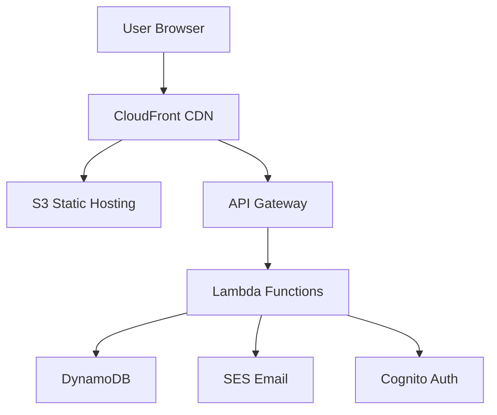

# Architecture Overview

## High-Level Architecture

## Components

### Frontend
- React 18 SPA hosted on S3
- CloudFront CDN for global delivery
- Responsive design with Tailwind CSS

### Backend
- API Gateway (REST)
- Lambda functions (Node.js 20)
- DynamoDB tables for books, orders, users

### Authentication
- Amazon Cognito User Pool
- JWT token-based auth
- Social sign-in support (Google, Apple)

### Infrastructure
- AWS CDK for IaC
- CloudWatch for monitoring
- X-Ray for tracing
