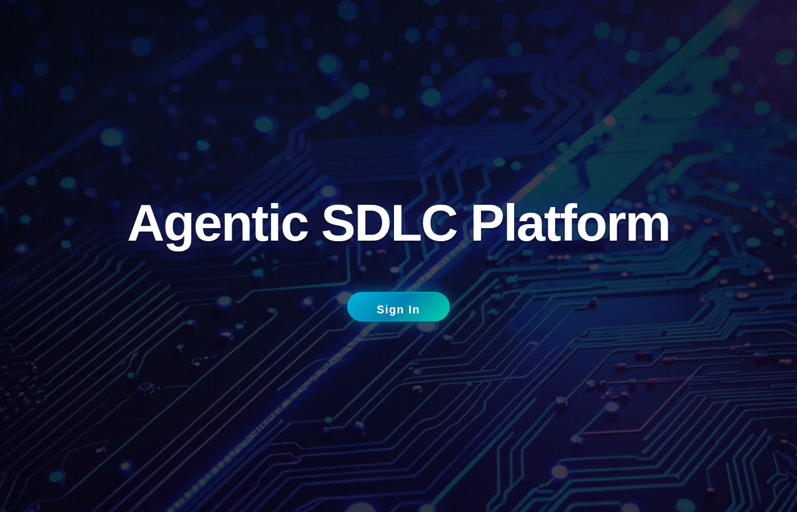
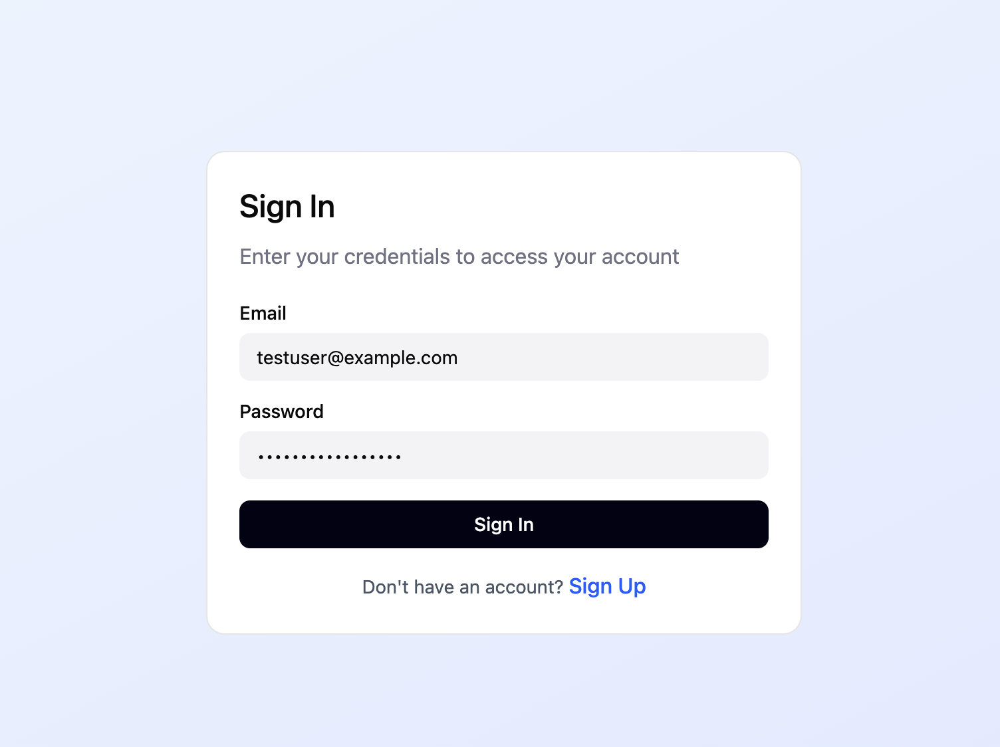

# Agentic SDLC Transformation — User Guide

This guide walks through deploying the platform from a clean machine, signing in, and running the full Business Analyst → Solution Architect handoff. It is the companion to the high-level [README](../README.md).

## Contents

- [1. Prerequisites](#1-prerequisites)
- [2. Configure AWS access](#2-configure-aws-access)
- [3. Enable Bedrock model access](#3-enable-bedrock-model-access)
- [4. Clone and install](#4-clone-and-install)
- [5. Bootstrap CDK](#5-bootstrap-cdk-first-time-only)
- [6. Deploy the stack](#6-deploy-the-stack)
- [7. Capture the stack outputs](#7-capture-the-stack-outputs)
- [8. Sign in for the first time](#8-sign-in-for-the-first-time)
- [9. Run the BA → SA → Developer workflow](#9-run-the-ba--sa--developer-workflow)
- [10. Inviting additional users](#10-inviting-additional-users)
- [11. Where artifacts live](#11-where-artifacts-live)
- [12. Tear down](#12-tear-down)
- [Appendix A — Account guard and the deployment account](#appendix-a--account-guard-and-the-deployment-account)
- [Appendix B — Troubleshooting](#appendix-b--troubleshooting)

---

## 1. Prerequisites

Install these on your workstation:

| Tool       | Minimum version | Install                                                                 |
| ---------- | --------------- | ----------------------------------------------------------------------- |
| AWS CLI v2 | latest          | https://docs.aws.amazon.com/cli/latest/userguide/getting-started-install.html |
| Node.js    | 20+             | https://nodejs.org/                                                     |
| Yarn       | 1.22+           | `npm install -g yarn`                                                   |
| AWS CDK    | 2.x             | `npm install -g aws-cdk`                                                |
| Docker     | running         | https://www.docker.com/get-started/                                     |

You also need:

- An AWS account with permissions to create CloudFormation, Cognito, S3, Lambda, IAM, API Gateway, Bedrock (including AgentCore), CloudFront, CodeBuild, Secrets Manager, and SSM Parameter Store resources. `AdministratorAccess` works for first deploy.
- The ability to enable Bedrock foundation-model access in the target region.

---

## 2. Configure AWS access

```bash
aws configure
```

Provide:

- **AWS Access Key ID / Secret** for the account you intend to deploy to.
- **Default region** — the platform defaults to `us-east-1`. You can override at deploy time with `-c region=<id>` or by setting `CDK_DEFAULT_REGION`.

Verify the credentials resolved to the expected account:

```bash
aws sts get-caller-identity
```

If that account does not match the pinned default account in `cdk/lib/utils/account-guard.ts`, the deploy will halt with an actionable error. See [Appendix A](#appendix-a--account-guard-and-the-deployment-account).

---

## 3. Enable Bedrock model access

The runtime calls Bedrock for model inference. The default model is `us.anthropic.claude-sonnet-4-6` (cross-region inference profile). It must be enabled in the AWS console for the deployment to function:

1. Open the [Amazon Bedrock console](https://console.aws.amazon.com/bedrock/) in your target region.
2. Choose **Model access** in the left navigation.
3. Click **Manage model access**.
4. Tick the model the runtime is configured to use, then **Save changes**.
5. Wait for "Access granted" — usually a few minutes.

If you skip this step the deploy will succeed but the agent will fail at first invocation with `AccessDeniedException`.

---

## 4. Clone and install

```bash
git clone <repo-url> sample-ai-driven-development-lifecycle-platform
cd sample-ai-driven-development-lifecycle-platform
yarn install
```

`yarn install` installs the root tooling and the CDK workspace under `cdk/`.

---

## 5. Bootstrap CDK (first time only)

CDK needs a one-time bootstrap per account/region pair to create the asset staging bucket and IAM roles it uses for deploys:

```bash
yarn workspace cdk cdk bootstrap
```

If your AWS profile resolves to the right account but a different region than you intend to deploy to, pass it explicitly:

```bash
yarn workspace cdk cdk bootstrap aws://<account>/<region>
```

You only need to do this once per account/region — `cdk` will reuse the bootstrap stack on subsequent deploys.

---

## 6. Deploy the stack

```bash
yarn deploy-infrastructure
```

Under the hood this runs:

1. `scripts/package-assets.sh` — packages the agent runtime source, the React UI build, the Lambda zips, and the project context bundle, and uploads them all to `s3://aidlc-assets-<account>-<region>/`. The bucket is created if it doesn't already exist.
2. `yarn workspace cdk cdk deploy --require-approval never -c assetsBucketName=<bucket>` — synthesizes and deploys the `AIDLCPlatformWorkshop` stack, which provisions:
   - Cognito User Pool, PKCE app client, hosted domain, and the post-confirmation Lambda that maps `custom:role` → Cognito group.
   - Two pre-provisioned test users (BA and SA) using `AwsCustomResource`.
   - The AgentCore Gateway, Memory, and Runtime (the Runtime image is built by a CodeBuild project from the packaged source — this is the long pole, ~10 minutes).
   - The Project API (`POST /projects`, `GET /projects`, `GET/POST/DELETE /projects/{projectId}`, `POST /projects/{projectId}/transition`, `POST /projects/{projectId}/reassign`, `POST /projects/{projectId}/upload-url`) and its Cognito-authorizer.
   - The S3 + CloudFront frontend distribution with `/config.json` populated from CDK at deploy time.
   - All the IAM, Secrets Manager, SSM Parameter Store, and CloudWatch wiring.

First deploy: **15–20 minutes**. Subsequent deploys are faster because the assets bucket is reused and CodeBuild caches the container layers.

### Pass an "Open IDE" link (optional)

If you want the project workspace to expose an "Open IDE" button (pointing to a hosted IDE), run the deploy with `-c ideUrl=…`:

```bash
ASSETS_BUCKET=$(bash scripts/package-assets.sh | tail -n 1)
yarn workspace cdk cdk deploy \
  --require-approval never \
  -c assetsBucketName=${ASSETS_BUCKET} \
  -c ideUrl=https://your-ide.example.com
```

Omit the flag (or use `yarn deploy-infrastructure`) to hide the button.

### Deploying to a non-default account

The CDK app is pinned to a default deployment account by `cdk/lib/utils/account-guard.ts`. To deploy elsewhere intentionally:

```bash
ASSETS_BUCKET=$(bash scripts/package-assets.sh | tail -n 1)
yarn workspace cdk cdk deploy \
  --require-approval never \
  -c assetsBucketName=${ASSETS_BUCKET} \
  -c account=123456789012
```

`-c account=…` is the only escape hatch — see [Appendix A](#appendix-a--account-guard-and-the-deployment-account).

---

## 7. Capture the stack outputs

When deploy completes, the CDK CLI prints the stack outputs. The ones you need to log in are:

| Output                | Description                                                |
| --------------------- | ---------------------------------------------------------- |
| `AIDLCPlatformURL`    | CloudFront URL of the web UI                               |
| `BATestUserEmail`     | Email for the pre-provisioned Business Analyst user        |
| `BATestUserPassword`  | Initial password for the BA user                           |
| `SATestUserEmail`     | Email for the pre-provisioned Solution Architect user      |
| `SATestUserPassword`  | Initial password for the SA user                           |
| `MaintTestUserEmail`    | Email for the pre-provisioned Maintenance Specialist user (operations dashboard) |
| `MaintTestUserPassword` | Initial password for the Maintenance Specialist user     |
| `TestUserEmail`         | Email for the pre-provisioned developer user             |
| `TestUserPassword`      | Initial password for the developer user                  |

All four test users are provisioned by one Lambda-backed custom resource (`<projectName>-test-user-provisioner`); their `custom:role` attributes map to the `requirements-analyst`, `system-architect`, `maintenance-specialist`, and `software-developer` groups respectively.

You can fetch them again at any time:

```bash
aws cloudformation describe-stacks \
  --stack-name AIDLCPlatformWorkshop \
  --query "Stacks[0].Outputs" \
  --output table
```

To grab a single value (handy for scripts):

```bash
aws cloudformation describe-stacks \
  --stack-name AIDLCPlatformWorkshop \
  --query "Stacks[0].Outputs[?OutputKey=='AIDLCPlatformURL'].OutputValue" \
  --output text
```

---

## 8. Sign in for the first time

1. Open the `AIDLCPlatformURL` value from the outputs in your browser.

   <p align="center">
     
   </p>

2. Click **Sign In**. You'll be taken to the Cognito-hosted login page.

   <p align="center">
     
   </p>

3. Enter the **`BATestUserEmail`** and **`BATestUserPassword`** values from the stack outputs.

4. Cognito will prompt you to set a new permanent password the first time you sign in for either test user. Choose a password that meets the User Pool's policy (mixed case, digits, symbols, ≥ 8 chars by default).

5. After sign-in you're returned to the portal's project list. The `custom:role` attribute on each test user is set at provision time (`requirements-analyst` for the BA user, `system-architect` for the SA user); the post-confirmation Lambda already added them to the matching Cognito group, so the UI immediately knows which actions to expose to each persona.

> The same flow works for self-signed-up users. Click **Sign Up** on the hosted page, choose a persona role on the registration form, and complete the email-verification step — the post-confirmation trigger will assign the group automatically.

---

## 9. Run the BA → SA → Developer workflow

This section walks the project through the full handoff chain. Have the BA, SA, and Developer test users' credentials handy.

### 9.1. As the Business Analyst — create a project

1. Sign in with the BA test credentials (Section 8).
2. Click **Create Project**, enter a name (for example, `Online Bookstore`) and a short description, then **Create**.
3. The project opens in its workspace: chat panel in the center, file browser + progress panel on the left, and document viewer on the right. Above the file browser the **Upload requirements document** control is visible because you are signed in as a BA.
4. (Optional) **Upload a requirements doc.** The control accepts `.md`, `.txt`, `.pdf`, and `.docx`. The frontend validates the extension client-side, requests a presigned PUT URL from the Project API (which is owner-gated server-side), and uploads the file directly to S3 under `aidlc-docs/inception/requirements/uploaded/<filename>`. PDFs and DOCX files are extracted to plain text via the Gateway's `extract_document_text` tool and the extracted text becomes the agent's authoritative requirements baseline.
5. The chat panel greets you and asks whether to start. Confirm.
6. The runtime begins the BA segment: workspace detection, optional reverse engineering, requirements analysis, then user stories. STEP 0 of the requirements agent reads any uploaded documents — if present, the agent only asks gap/ambiguity questions; if absent, it asks the full clarifying question set.
7. After user stories are generated and approved, the workflow reaches the **handoff gate**. The chat shows a "Handoff: Business Analyst → Solution Architect" card with an **Assign to Solution Architect** button.
8. Click the button. The Project API records the transition `requirements_ready → assigned_to_sa`, ownership flips to the SA persona, and the WebSocket session ends. The project now shows an **Awaiting Solution Architect** badge in the project list.

### 9.2. As the Solution Architect — review and decide

1. Sign out and sign back in with the SA test credentials. (Or use a separate browser profile if you'd prefer to keep both sessions open.)
2. The project list shows the same `Online Bookstore` project — cross-creator visibility is by design — with an **Assigned to you** badge.
3. Click the project. The workspace opens with the **Solution Architect review panel** above the chat. The panel loads `requirements.md`, `stories.md`, and `personas.md` from the project's shared S3 prefix.
4. Review the artifacts. Click between tabs as needed. Then choose:
   - **Approve & continue** — transitions the record `assigned_to_sa → in_design` and forwards `Approve & Continue` to the runtime so the design agents pick up the work.
   - **Request changes** — reveals an optional note field, then transitions `assigned_to_sa → requirements_ready` (ownership flips back to the BA) and forwards `Request Changes` to the runtime. Your note is recorded in the project's `assignment_history`. The BA will see a **Changes requested** badge on the project list and address the feedback before reassigning.

### 9.3. As the Solution Architect — design through `ready_for_dev`

After approval, the workflow proceeds through application design and units generation.

1. The agent runs through `workflow_planning` → `application_design` (with optional design extensions) → `units_generation`.
2. When the agent reaches the **Design completion** state (`in_design`), the SA review panel shows a **Mark design ready** button. Clicking it advances the record `in_design → design_ready`.
3. From `design_ready` the panel shows **Mark ready for development**. Clicking it advances `design_ready → ready_for_dev` — the terminal state.

The portal's document viewer now shows the full set of generated artifacts: requirements, user stories, personas, the design plan, the application design, and any units the project generated. Take these into your IDE of choice for the construction phase.

<p align="center">
  
</p>

### 9.4. The bounce path

If the SA selected **Request changes**, the BA reconnects, addresses the note, and reassigns. Repeat 9.1–9.2 from the BA reassign step. The `assignment_history` on the project record captures every transition with the actor, timestamp, and (for bounces) the SA's note — visible in the underlying record at `_platform/projects/{uuid}.json` for audit.

### 9.5. The operations dashboard (Maintenance Specialist)

Sign in as the **Maintenance Specialist** (`MaintTestUserEmail` / `MaintTestUserPassword`) to get a read-only, cross-project operations view:

1. After sign-in, a **Dashboard** button appears at the top-right of the project list (shown only to the `maintenance-specialist` group).
2. Click it to open `/dashboard`, which lists **every** project with its **current stage** (e.g. "Assigned to Solution Architect") and the **persona it is assigned to**, plus a per-persona workload summary and a by-stage rollup.
3. The dashboard is **read-only** — it performs no transitions. A non-maintenance persona that navigates to `/dashboard` directly is shown an "unavailable" message. The view reads the same broad `GET /projects` listing the rest of the UI uses (visibility is broad by design; only *actions* are owner-gated).

### 9.6. The Software Developer handoff

After the SA finishes design, the SA's session ends with an **"Assign to Software Developer"** handoff card (the same mechanism as the BA→SA card). Clicking it advances the project to `assigned_to_dev`.

Sign in as the **Software Developer** (`TestUserEmail` / `TestUserPassword`, the `software-developer` user) and open the project:

1. The `construction_handoff` agent runs and writes a **construction brief** to `aidlc-docs/construction/construction-brief.md` (a consolidated, ready-to-paste coding-agent prompt that folds in the requirements, user stories, NFRs, design, and units) plus one task file per unit under `aidlc-docs/construction/tasks/`.
2. Click **Download construction brief** and open it in your AI-assisted IDE (Kiro / Claude Code / Cursor) to generate the implementation, infrastructure, and tests — construction happens in the IDE, not in the platform.
3. Push your work to **GitHub/GitLab**, then use **Link repo & submit for QA** (optionally supplying a private-repo access token). This advances the project to `implementation_submitted` and triggers a **CodeBuild ingestion** job that clones the repo and syncs the source into `{project_id}/source/`, then advances the project to `assigned_to_qa`. A signature-verified **push webhook** can re-trigger ingestion automatically.
4. If the design needs revision, the developer can bounce the project back to the SA (`assigned_to_dev → design_ready`).

### 9.7. QA and DevOps

Sign in as the **QA Engineer** (`QATestUserEmail` / `QATestUserPassword`) to review the test plan/results/report on the ingested code, optionally **Run tests** (a CodeBuild test-runner), and advance (`assigned_to_qa → in_qa → qa_passed`) or bounce back to the developer (`in_qa → assigned_to_dev`). Then sign in as the **DevOps Engineer** (`DevOpsTestUserEmail` / `DevOpsTestUserPassword`) to produce the deployment plan + release runbook and advance to the terminal `deployed` state (or bounce to QA). All six logins are printed as stack outputs; the initial password is set via the `AIDLC_DEMO_USER_PASSWORD` environment variable at deploy time.

---

## 10. Inviting additional users

The pre-provisioned test users (BA, SA, Software Developer, QA Engineer, DevOps Engineer, Maintenance Specialist) are convenient for first run; for real use, sign up new users from the hosted Cognito page:

1. Open `AIDLCPlatformURL` in a private browser window.
2. Click **Sign In** → **Sign up** on the hosted page.
3. Provide an email, password, and **persona role** (the sign-up form sends the group name as `custom:role`).
4. Complete email verification.
5. The post-confirmation trigger maps `custom:role` to the matching Cognito group automatically — the user immediately sees the right persona surfaces on next login.

The valid persona role values are:

```text
requirements-analyst   → Business Analyst
system-architect       → Solution Architect
software-developer     → Software Developer
qa-engineer            → QA Engineer
devops-engineer        → DevOps Engineer
maintenance-specialist → Maintenance Specialist (read-only operations dashboard)
```

Any value outside that set is rejected by the post-confirmation trigger and the user is created without a group (so they can sign in but won't see any owner-gated actions).

---

## 11. Where artifacts live

Per project, the runtime and Project API write to the same S3 bucket. The keys you'll most often interact with:

| Key                                                       | Owner          | Contents                                       |
| --------------------------------------------------------- | -------------- | ---------------------------------------------- |
| `_platform/projects/{project_uuid}.json`                  | Project API    | Authoritative project record, handoff state, history |
| `{project_id}/aidlc-docs/aidlc-state.md`                  | Runtime        | Mirror of SharedState including handoff       |
| `{project_id}/aidlc-docs/inception/requirements/uploaded/<file>` | BA upload | Original uploaded requirements doc            |
| `{project_id}/aidlc-docs/inception/requirements/uploaded/extracted/<file>.txt` | Gateway extractor | Extracted plain text from `.pdf` / `.docx` |
| `{project_id}/aidlc-docs/inception/requirements/requirements.md` | Requirements agent | Generated requirements              |
| `{project_id}/aidlc-docs/inception/user-stories/stories.md`      | Stories agent | Generated user stories                       |
| `{project_id}/aidlc-docs/inception/user-stories/personas.md`     | Stories agent | Generated personas                           |
| `{project_id}/aidlc-docs/inception/application-design/*.md`     | Design agents | Generated design artifacts                   |

The frontend's file browser shows everything under `{project_id}/`; the document viewer renders Markdown inline. Note that the `aidlc-docs/` artifact folder is **displayed as `agentic-sdlc`** in the file browser — this is a label-only change; the actual S3 keys and file names (e.g. `aidlc-docs/inception/.../requirements.md`, `aidlc-state.md`) are unchanged, so the paths in the table above remain the real keys.

---

## 12. Tear down

```bash
yarn delete-infrastructure
```

This runs `cdk destroy` against the `AIDLCPlatformWorkshop` stack. To also delete the staging bucket created outside the stack (`aidlc-assets-<account>-<region>`):

```bash
ACCOUNT=$(aws sts get-caller-identity --query Account --output text)
REGION=${AWS_REGION:-us-east-1}
aws s3 rb s3://aidlc-assets-${ACCOUNT}-${REGION} --force
```

The web bucket (`aidlc-ui-…`) is created **inside** the stack and removed by `cdk destroy`. The project bucket (which holds the per-project `aidlc-docs/` artifacts and the `_platform/projects/` records) follows the stack's removal policy — verify it is empty if you want a complete cleanup.

---

## Appendix A — Account guard and the deployment account

`cdk/bin/cdk.ts` invokes `assertExpectedAccount(resolveAccount(...))` before constructing the stack. The behavior:

| `-c account=<id>` supplied | `CDK_DEFAULT_ACCOUNT` set                | Resolved account               | Guard outcome             |
| -------------------------- | ---------------------------------------- | ------------------------------ | ------------------------- |
| Yes, any value             | irrelevant                               | the supplied value             | passes (override honored) |
| No                         | matches the pinned default               | the env value                  | passes                    |
| No                         | does not match the pinned default        | the env value                  | **halts** with an actionable error naming both the resolved account and the expected account |
| No                         | unset                                    | the pinned default             | passes                    |

Region defaults to `us-east-1` and is **not** gated; override with `-c region=<id>` or `CDK_DEFAULT_REGION`.

To redirect a deploy intentionally:

```bash
ASSETS_BUCKET=$(bash scripts/package-assets.sh | tail -n 1)
yarn workspace cdk cdk deploy \
  --require-approval never \
  -c assetsBucketName=${ASSETS_BUCKET} \
  -c account=123456789012 \
  -c region=us-west-2
```

---

## Appendix B — Troubleshooting

**`Account mismatch: the resolved AWS account '…' does not match …`**
Your AWS credentials resolved to a different account from the pinned default. Either set credentials for the expected account, or pass `-c account=<id>` to deploy elsewhere intentionally (Appendix A).

**`Missing CDK context 'assetsBucketName'`**
You ran `cdk deploy` directly. Either run `yarn deploy-infrastructure` (which packages assets and passes the context flag for you) or run `bash scripts/package-assets.sh` first and then pass `-c assetsBucketName=<bucket>` to `cdk deploy` yourself.

**`AccessDeniedException` from Bedrock at runtime**
Model access isn't enabled in the deploy region. Section 3.

**Stack stuck on the Runtime image build**
The agent runtime image is built by a CodeBuild project from the packaged source. The build is idempotent and retried by CloudFormation. Tail the CodeBuild logs in the AWS console under **CodeBuild → Build projects** if it appears stuck.

**Sign-in works but no persona surfaces appear**
The post-confirmation trigger only fires after **email verification**. If you confirm a user manually with `aws cognito-idp admin-confirm-sign-up`, the trigger does not run; instead use `aws cognito-idp admin-add-user-to-group` to assign the persona group manually, or have the user complete the standard email-verification flow.

**`yarn delete-infrastructure` leaves resources behind**
Two buckets are created outside the stack and survive `cdk destroy`:

- `aidlc-assets-<account>-<region>` — staging bucket for deploy assets
- The project bucket if its removal policy is `RETAIN`

Empty and delete each one explicitly if you want a complete cleanup.

**Two-persona handoff scripted scenario fails locally**
`scripts/verify-two-persona-handoff.sh` runs the Python and frontend halves end-to-end against in-memory fakes. If the Python venv at `cdk/custom-resources/.venv-project-api` doesn't exist, create it with the project API's requirements: `python3 -m venv cdk/custom-resources/.venv-project-api && source $_/bin/activate && pip install -r cdk/custom-resources/requirements.txt`.

---